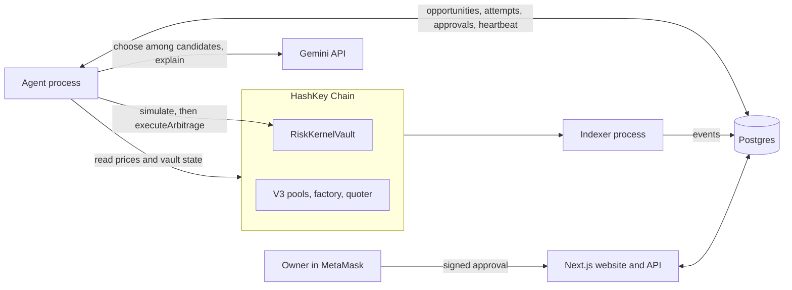
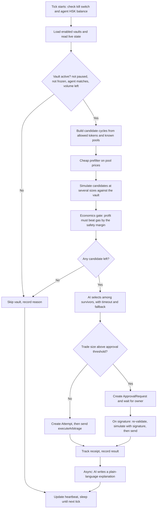
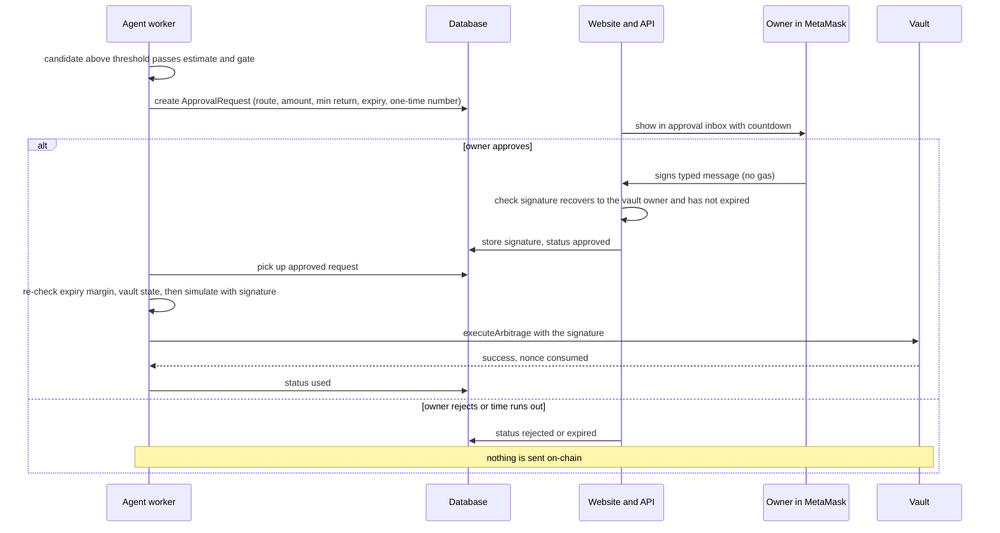
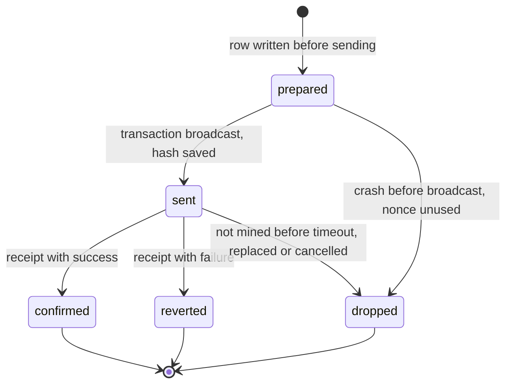

# Risk Kernel — Phase 2: Agent Worker Implementation Plan

**What this covers:** the Node.js worker that finds arbitrage cycles on HashKey Chain and trades them through each user's `RiskKernelVault`, including the human-in-the-loop approval path.
**Contract changes needed:** none. The deployed `RiskKernelVault` already has `executeArbitrage`, the approval check, and the token and router allowlists.
**Status:** planning document. No code.

---

## 1. Scope in one paragraph

The vault is a rulebook that never acts by itself. The worker is the program that acts. Every few seconds it looks at the pools, builds candidate cycles, tests them against the real contract without spending gas, picks the best one, and sends it from the **agent wallet**. For large trades it first asks the owner for a signed approval. The vault re-checks every rule on-chain, so the worker can be wrong without costing the user money. A wrong guess costs the agent wallet some gas.

---

## 2. What the worker does and does not do

| It does | It does not |
|---|---|
| Read pool prices and vault state from the chain | Hold or touch user funds (the vault does) |
| Build, simulate and send `executeArbitrage` | Change a vault's rules (only the owner can) |
| Create approval requests and use signed approvals | Sign approvals (only the owner's wallet can) |
| Ask Gemini to choose among already-validated candidates and to explain results | Let Gemini produce prices, profit numbers or addresses |
| Record every attempt and a heartbeat in the database | Serve the website (the Next.js app does) |

---

## 3. Inputs still needed (confirm before building)

| # | Item | Why | Fallback if missing |
|---|---|---|---|
| 1 | V3 factory address (call `factory()` on the router) | To find pools with `getPool` | Hardcode the known WHSK/USDT 0.3% pool only |
| 2 | Quoter address and ABI, if HashKey deployed one | Quotes for trade sizes above the approval threshold | Quote locally from pool data, or only quote at sizes within the threshold |
| 3 | Which fee tiers are enabled on the factory | Candidate generation | Assume 100, 500, 3000, 10000 and check each with `getPool` |
| 4 | Other tokens with deep pools and a second WHSK/USDT pool | Without them there is almost nothing to trade | Testnet mocks for the demo |
| 5 | RPC provider with higher limits (from HashKey's RPC docs page) | The public endpoint may rate-limit a polling loop | Slow the loop down |
| 6 | Hosting choice for the worker (Railway, Render, a VPS, or a laptop for the demo) | Needs to run continuously | Laptop for the hackathon demo |
| 7 | Gemini model ID | Pick from Google AI Studio on build day | Config value, easy to change |

---

## 4. Process model

Run **two separate processes** from one repository, so the event indexer keeps running even when trading is switched off.

| Process | Job | Can be stopped without hurting |
|---|---|---|
| **Indexer** (built in Phase 1) | Copies vault events into the database | The agent |
| **Agent** (this plan) | Scans, simulates, sends, handles approvals | The indexer and the website |

The database is the only link between the website and the agent. Neither calls the other directly.

---

## 5. Data the worker reads and writes

### 5.1 Reads from the chain
- **Vault state** (per vault, fresh each tick): `paused`, `frozen`, `agent`, `baseAsset`, `balance`, `mandate`, `volumeRemainingToday`, `isTokenAllowed`, `isRouterAllowed`, `requiresApproval`.
- **Pools:** price and liquidity for each candidate pool.
- **Gas:** current gas price, and the agent wallet's HSK balance.
- **Prices for gas conversion:** the WHSK/USDT pool price, treating WHSK as equal to HSK.

### 5.2 Tables the worker uses

| Table | Status | Purpose |
|---|---|---|
| `Vault` | Phase 1 | Registry of vaults the worker may serve, with an `enabled` flag |
| `ActivityEvent` | Phase 1 | Event history (written by the indexer) |
| `Token` | New | Address, symbol, decimals, enabled |
| `Pool` | New | Pool address, token pair, fee tier, last seen, liquidity estimate, enabled |
| `Opportunity` | New | Each candidate that passed all checks: route, size, expected profit, decision |
| `Attempt` | New | One row per transaction the worker intends to send, written **before** sending |
| `ApprovalRequest` | New | Pending, approved, rejected and expired requests with the signature |
| `WorkerHeartbeat` | New | Last loop time, last block, agent HSK balance, status, last error |
| `WorkerFlag` | New | Global and per-vault kill switches |

### 5.3 Status values the website relies on

| Table | Statuses |
|---|---|
| `Opportunity` | `detected`, `skipped`, `sent`, `confirmed`, `reverted`, `awaiting_approval` |
| `ApprovalRequest` | `pending`, `approved`, `rejected`, `expired`, `used`, `failed` |
| `Attempt` | `prepared`, `sent`, `confirmed`, `reverted`, `dropped` |

---

## 6. Configuration

All values come from environment variables, with the secret in a secret manager. Nothing is hardcoded.

| Variable | Purpose |
|---|---|
| `CHAIN_ID`, `RPC_URL` | 177 or 133, and the provider endpoint |
| `AGENT_PRIVATE_KEY` | The agent wallet. Never logged, never in the web app |
| `DATABASE_URL` | Postgres connection |
| `BASE_ASSET`, `ROUTER`, `V3_FACTORY`, `QUOTER` | Chain addresses (quoter optional) |
| `GEMINI_API_KEY`, `GEMINI_MODEL`, `AI_MODE` | `select` (AI chooses among candidates) or `explain_only` |
| `POLL_INTERVAL_MS` | Loop speed. Blocks are about 2 seconds, so faster than that gains nothing |
| `SIZE_FRACTIONS` | Trade sizes to test, for example 100%, 50%, 25%, 10% |
| `MIN_NET_PROFIT_USDT`, `GAS_SAFETY_MULTIPLIER` | The profit gate (section 10) |
| `PROFIT_HAIRCUT_PCT` | How much of the simulated profit becomes the on-chain minimum |
| `MAX_GAS_PRICE_GWEI` | Never send above this (a live transaction showed a 500 gwei base fee, so set it with that in mind) |
| `MAX_TRADE_USDT` | Worker-side cap below the vault's own cap (use tiny values on mainnet) |
| `MIN_AGENT_HSK` | Stop sending when the agent wallet is below this |
| `SIMULATE_ONLY` | Testing flag: runs everything except sending |
| `KILL_SWITCH_DEFAULT` | Start paused or running |

---

## 7. Modules

| Module | Responsibility |
|---|---|
| **config** | Load and validate the environment. Refuse to start with missing or inconsistent values (for example chain ID versus RPC) |
| **chain** | Provider, signer, vault and pool contract helpers, and the custom-error decoder built from the vault's ABI |
| **registry** | Which vaults to serve. Keeps only vaults where `agent()` equals our wallet and `baseAsset()` equals the configured USDT |
| **catalog** | Token and pool lists. A slower discovery job refreshes pools from the factory every few minutes, not every tick |
| **scanner** | Reads pool prices and builds the candidate cycle list |
| **simulator** | Tests candidates against the real vault with a read-only call. Extracts exact outputs |
| **sizer** | Picks the best trade size under all limits |
| **economics** | Converts gas to USDT, applies the profit gate and sets the on-chain minimum profit |
| **ai** | Candidate selection (with timeout and fallback) and plain-language explanations |
| **approvals** | Creates requests, watches for signatures, re-validates before sending |
| **executor** | Nonce management, transaction sending, receipt tracking, replacement of stuck transactions |
| **reconciler** | On startup, resolves any attempt left half-finished |
| **state** | Database access and the single-instance lock |
| **ops** | Heartbeat, kill switches, rate limits, alerts and structured logging |
| **cli** | Commands: run, run once, simulate-only, and a status check |

---

## 8. The tick loop

One tick is one pass over all enabled vaults. Ticks never overlap: the next one starts only when the previous one finishes and the poll interval has passed.

**Order inside a tick (per vault):**
1. Read state. Stop early on any blocking condition.
2. Generate candidates.
3. Prefilter, simulate, size.
4. Apply the gas gate.
5. Choose one cycle per vault per tick (avoid sending several overlapping trades from the same vault).
6. Send or request approval.
7. Record everything, including the reasons for skipping.

---

## 9. Finding candidates

### 9.1 Pool discovery (slow job)
For each pair of tokens in the catalog and each fee tier, ask the factory's `getPool`. Keep pools that exist and have non-trivial liquidity. Save them to `Pool`. Re-run every few minutes, and immediately after a `PolicyApplied` event that adds a token.

### 9.2 Candidate shapes

| Shape | Example | Notes |
|---|---|---|
| Two-step, same pair, different fee tiers | USDT → WHSK (0.3%) → USDT (0.05%) | Needs two pools for the same pair. Same tier both ways is the same pool and can never profit |
| Three-step triangle | USDT → A → B → USDT | Needs pools USDT/A, A/B and B/USDT |
| Four-step | USDT → A → B → C → USDT | Allowed by the vault (max 4 steps). Off by default |

Every candidate is built as the contract's `Step` list: router, kind `1` (original SwapRouter with deadline), token in, token out, fee tier.

### 9.3 Cheap prefilter
Compare pool prices before spending any RPC calls on simulation. A cycle is worth simulating only if the price edge exceeds the sum of the fee tiers plus a small buffer. This price ignores depth and ticks, so it only removes obvious non-starters. The simulation gives the real answer.

### 9.4 Only use what the vault allows
Drop any candidate that uses a token or router the vault doesn't allow. Refresh each vault's allowlist when a `PolicyApplied` event appears, or by calling `isTokenAllowed` and `isRouterAllowed` during the tick.

---

## 10. Simulating and sizing

### 10.1 The vault is the simulator
Run a read-only call to `executeArbitrage` **from the agent address**. It runs the real router on current pool state and applies the vault's own checks.

**Trick to get an exact quote:** call it with a deliberately huge `minProfit`. The vault reverts with `InsufficientReturn(returned, required)`, and the `returned` value is exactly what the cycle would give back right now. The profit is `returned − amountIn`. No Quoter is needed for sizes where this works.

### 10.2 The approval-threshold catch
When a size is above the vault's `approvalThreshold`, the vault demands a valid owner signature **before** it runs any swaps, so the trick above fails with `ApprovalRequired`. For those sizes:
- Use the **Quoter** (or local pool math) to estimate profit.
- After the owner signs, run the simulation again **with the signature** before sending.

If no quoter exists, the plan degrades safely: simulate only at sizes within the threshold, and treat anything above it as "approval needed, estimate approximate".

### 10.3 Sizing procedure
1. Compute the largest allowed size: the smallest of the vault's `maxPositionSize`, its balance, its `volumeRemainingToday`, the worker's `MAX_TRADE_USDT`.
2. Simulate each fraction in `SIZE_FRACTIONS` of that size.
3. For each, compute net profit after gas (section 11).
4. Keep the size with the best net profit. On thin pools, the best size is often smaller than the maximum, because bigger trades move the price against you.
5. Cap concurrent RPC simulations to avoid rate limits.

---

## 11. Economics: the gas gate

The **vault does not pay gas. The agent wallet does,** including on trades that revert. So the worker must protect itself separately from the vault's rules.

1. **Estimate gas** for the real transaction, then multiply by the current gas price (respecting `MAX_GAS_PRICE_GWEI`). Add a small allowance for the L1 data fee (about 0.02% of total cost in the transaction we looked at).
2. **Convert to USDT** with the WHSK/USDT pool price.
3. **Gate:** send only if `profit ≥ gas cost × GAS_SAFETY_MULTIPLIER` and `profit ≥ MIN_NET_PROFIT_USDT`.
4. **Set the on-chain minimum** to the simulated profit after `PROFIT_HAIRCUT_PCT` (for example keep 60 to 70%). The vault will cancel the trade if the market moves more than that. This is what makes losses to the vault impossible.
5. **Track the agent wallet's cumulative gas spend** versus profit earned by vaults, in the database, so you can see whether the operator is paying more than it saves anyone.

**Honest point for the pitch:** on a $5 vault, profits are cents and gas is about a cent, so the gate will reject most opportunities. That is correct behaviour. Decide who funds the agent's gas (the team during the hackathon, a fee in a real product).

---

## 12. Approvals (human-in-the-loop)

**Rules for the worker side:**
- **One pending request per vault.** Don't create another until the first is settled.
- **Request contents:** the exact route, `amountIn`, `minProfit`, expiry (2 to 5 minutes), and a random one-time number. The route's `cycleHash` comes from the contract's `hashCycle` view, checked once at startup against the worker's local encoding.
- **Send exactly what was signed.** The signature covers the route, the amount and the minimum return. Changing any of them voids it.
- **Margin before sending:** skip if fewer than about 20 seconds remain before expiry.
- **Stale approvals:** if the re-simulation fails (spread gone, vault paused), mark the request `failed` and do not retry with the same signature.
- **Cooldowns:** after a rejection, don't request the same route for a set time (for example 10 minutes), so the owner isn't spammed.
- **Never a silent send:** no signature means no transaction, always.
- **Limit above-threshold requests** to opportunities with meaningful profit, since every request costs the owner attention.

---

## 13. Where the AI fits

| Step | AI role | Guardrails |
|---|---|---|
| **Candidate selection** (`AI_MODE=select`) | Choose one candidate from the final list (up to about 5) that already passed all gates, and give a short reason | Strict JSON output. The chosen ID must be in the list. Timeout of a few seconds. On any failure, fall back to the highest net profit |
| **Explanation** (always) | After the transaction confirms, write a plain-language summary from stored numbers | Runs after the trade, never blocks it. If it fails, store a template sentence |
| **Chat tools** (website) | Read opportunities, approvals and agent status | Read-only. Already covered by the chat plan |

**What the AI never does:** invent or change prices, amounts, addresses or profit figures, send transactions, or decide whether a trade is allowed. The candidates it sees already satisfy every rule, so a poor AI choice can only cost the agent some profit, not the user's funds.

**Latency note:** opportunities can vanish within a few seconds. Use `explain_only` mode if the selection timeout makes you miss trades.

---

## 14. Sending transactions

| Topic | Plan |
|---|---|
| **Nonce** | One signer, one queue. Send one transaction at a time per agent wallet. Track the next nonce locally and recheck it against the chain after any error |
| **Deadline** | Set to about 60 seconds after sending, which is roughly 30 blocks at the 2-second block time |
| **Gas price** | Take the current fee data, respect the cap, add a small priority fee |
| **Gas limit** | Estimate, then add a margin |
| **Receipts** | Wait for confirmation with a timeout. Classify the result as confirmed, reverted or dropped |
| **Stuck transactions** | After a timeout, replace with the same nonce and a higher fee, or cancel with a zero-value transaction |
| **Idempotency** | Write the `Attempt` row (route, amounts, nonce) before sending, and add the hash after |
| **After confirmation** | Parse the `TradeExecuted` event: returned amount, profit and `approvalUsed`. Store it on the `Opportunity` |

### Attempt lifecycle and restart recovery

**On startup the reconciler:**
1. Finds attempts left in `prepared` or `sent`.
2. Looks up the receipt by hash, or checks whether the nonce was used.
3. Marks the attempt confirmed, reverted or dropped.
4. Never resends an attempt unless it has proven the transaction wasn't mined.

---

## 15. Error handling

Decode every failure with the vault's error list, then act:

| Error or failure | Meaning | Worker action |
|---|---|---|
| `InsufficientReturn` | Market moved or the spread is gone | Skip. Count it. Back off on that route briefly |
| `IsPaused`, `IsFrozen` | Owner paused, or the breaker tripped | Mark the vault inactive until an event says otherwise |
| `NotAgent` | Agent was revoked or replaced | Disable the vault in the registry |
| `DailyLimitExceeded` | Used up today's volume | Wait until the next UTC day |
| `PositionTooLarge`, `InsufficientBalance` | Cache is stale | Refresh the mandate and balance, then retry the sizing once |
| `TokenNotAllowed`, `RouterNotAllowed` | Allowlist changed | Refresh the allowlist, drop the candidate |
| `ApprovalRequired` | Above threshold with no signature | Go through the approval path |
| `ApprovalExpired`, `ApprovalAlreadyUsed`, `BadApprovalSigner` | Bad or stale signature | Mark the request failed. Never retry with it |
| `TradeExpired` | Deadline passed while waiting | Rebuild and resend, once |
| `ZeroOutput`, or a router error | Pool is empty or odd | Disable that pool for a while |
| RPC error or timeout | Provider problem | Retry with backoff, then pause sending if it persists |
| Database error | Can't record state | Stop sending (never trade without being able to record it) |
| Agent HSK below `MIN_AGENT_HSK` | Can't pay gas | Stop sending and raise an alert |

---

## 16. Safety controls and operations

### 16.1 Worker-side limits (on top of the contract's)
- Global **kill switch** and per-vault disable flag, stored in the database and checked every tick.
- Maximum trades per hour per vault, and a maximum gas spend per hour.
- Maximum reverts per hour per vault. After that, pause the vault for a cooldown.
- `MAX_TRADE_USDT` and `MAX_GAS_PRICE_GWEI` caps.
- Only one trade in flight per vault.

### 16.2 Single-instance lock
Take a database advisory lock at startup. A second instance exits, or waits on standby. Two workers with one key would collide on the nonce.

### 16.3 Heartbeat
Write one row each tick: time, latest block, loop duration, number of vaults, candidates, simulations, sends, agent HSK balance and the last error. The website reads it to show **running**, **no opportunities**, **waiting for approval** or **offline** if the last tick is older than a few intervals.

### 16.4 Logs and alerts
- Structured logs with the vault, candidate ID, attempt ID and transaction hash on every line. Never log the key or the full signatures.
- Alerts (Telegram, email or a simple log watcher) for: stale heartbeat, low agent HSK, repeated reverts, RPC failures, a database error and a tripped circuit breaker.

---

## 17. Security

| Topic | Plan |
|---|---|
| **Agent key** | A dedicated wallet that holds only the HSK needed for gas. Stored in a secret manager or environment secret. Never in the website, never in the repository, never logged |
| **Blast radius** | The key can only call the vault's agent functions, within the vault's rules. It can't withdraw or change settings |
| **One key for many vaults** | Acceptable for the hackathon. For production, use a separate key per vault or per user |
| **Vault checks at registration** | Phase 1's registration route confirms the owner and the contract's bytecode. The worker rechecks `agent()` and `baseAsset()` every tick |
| **Approval signatures** | The API verifies the recovered signer equals the vault's `owner()` before saving. The vault verifies it again on-chain |
| **Reordering and copying** | Anyone can see pending transactions. Profit-or-revert means a copied or front-run trade can only fail, never cost the vault money. It can still cost the agent gas |
| **Dependency hygiene** | Pin library versions, review any package that touches the key |

---

## 18. Testing

### 18.1 Unit tests (no chain)
- Fee-adjusted price edge for two-step and three-step candidates.
- Gas conversion and the profit gate.
- Haircut and minimum-profit calculation.
- Decoding `InsufficientReturn` to extract the returned amount.
- Error classification.
- Local `cycleHash` encoding versus the contract's `hashCycle` (compare against the deployed testnet vault).

### 18.2 Integration tests (local chain with the mock routers)
- Profitable cycle: the worker finds it, simulates it, sends it, and the vault's balance rises by the recorded profit.
- Spread removed between simulate and send: the transaction reverts, the vault's balance is unchanged, the attempt shows `reverted`.
- Paused and frozen vaults are skipped.
- Revoked agent: the vault is disabled in the registry.
- Daily limit exhausted: the vault is skipped until the next day.
- Allowlist change: a token removed stops being used, a token added (after the delay) starts being used.

### 18.3 Testnet end-to-end (the demo script)
1. Create the spread on the mock router and watch the opportunity, the trade, the dashboard and the explorer all agree.
2. Remove the spread and confirm no loss.
3. Lower the approval threshold and confirm the request appears in the inbox, the signature triggers the trade, and a rejection sends nothing.
4. Let a request expire and confirm nothing is sent.
5. Pause the vault in the website and confirm the worker stops within one tick.
6. Force a loss (testnet loss-tolerant mode) and confirm the breaker freezes the vault and the worker stops trading it.

### 18.4 Chaos tests
- Kill the worker between writing an attempt and sending it.
- Kill it after sending and before the receipt.
- Cut the RPC for a minute, then the database.
- Start two instances.
- Make the agent wallet run out of HSK.
- Send a stuck transaction (very low fee) and test the replacement.

### 18.5 Acceptance criteria

| # | Criterion |
|---|---|
| 1 | An opportunity creates a confirmed trade whose profit matches the on-chain `TradeExecuted` event and the vault balance change |
| 2 | An unprofitable cycle is never sent, and a reverted cycle never changes any vault balance |
| 3 | No transaction above the threshold is sent without a valid signature |
| 4 | Restarting the worker at any point causes no duplicate transaction |
| 5 | Pausing or freezing a vault stops trading within one tick |
| 6 | The heartbeat accurately shows running, idle, waiting for approval and offline |
| 7 | The agent wallet's gas spend and the vaults' profit are both visible in the database |
| 8 | A kill switch stops all sending immediately |

---

## 19. Deployment and runbook

| Stage | Setup |
|---|---|
| **Testnet** | Worker runs on a laptop or small server. Mock tokens and routers. `SIMULATE_ONLY` off. Loose limits |
| **Mainnet smoke test** | Tiny `MAX_TRADE_USDT`, tiny vault (about 5 USDT), agent wallet with a small HSK balance. Expect "no opportunities" for most of the time |
| **Demo** | Run on testnet for the live spread, and show one mainnet transaction to prove the real router call works |

**Runbook:**
- **Start:** check config, check the agent HSK balance, check the database, start the indexer first, then the agent.
- **Stop:** flip the kill switch, wait for the in-flight transaction to settle, then stop the process.
- **Wedged nonce:** stop the worker, check pending transactions, replace or cancel them, start again.
- **Incident:** flip the kill switch, tell affected owners, check the vault state on the explorer.
- **Key rotation:** create a new agent wallet, owners revoke the old agent or set the new one through the Policy Card (a riskier change, so it waits for the delay), then retire the old key.

---

## 20. Milestones

| # | Milestone | Days (one dev) |
|---|---|---|
| 0 | Gather inputs from section 3, set up the repo and config | 0.5 |
| 1 | Chain and database layers, vault helpers, error decoder | 1 |
| 2 | Token and pool catalog with discovery | 1 |
| 3 | Scanner, candidate builder, prefilter | 1.5 |
| 4 | Simulator, sizing and the economics gate | 1.5 |
| 5 | Executor, nonce handling, receipts, reconciler | 1.5 |
| 6 | Approval path (worker and API side) | 1.5 |
| 7 | AI selection and explanations | 1 |
| 8 | Heartbeat, kill switch, limits, alerts, lock | 1 |
| 9 | Tests, chaos runs, testnet end-to-end, mainnet smoke test | 2 |
| **Total** | | **about 12.5 days (about 7 days for two people)** |

Cut order if short on time: alerts, then the AI selector (keep explanations), then four-step routes, then the stuck-transaction replacement. Never cut the reconciler, the single-instance lock or the kill switch.

---

## 21. Risks

| Risk | Mitigation |
|---|---|
| Very few real opportunities on mainnet | Say so openly. Demo the mechanism on testnet mocks |
| Gas costs exceed profit on small vaults | The gas gate, the gas spend tracking, and a clear answer to who funds gas |
| Quoter missing | Revert-quote trick for sizes within the threshold, and an approximate estimate above it |
| Other bots take the spread first | The transaction reverts and costs only gas. Gas gate and revert limits contain it |
| RPC rate limits | A provider from HashKey's RPC page, caps on concurrent simulations |
| Gemini slow or wrong | Timeout and deterministic fallback, and it can only choose among validated candidates |
| Single shared agent key | Acceptable for the hackathon. Per-vault keys later |
| Unverified sequencer behaviour on HashKey Chain | Keep deadlines short and test on mainnet with tiny sizes |

---

## 22. Open questions

1. Is there a Quoter on HashKey Chain, and at what address?
2. Which other tokens and fee tiers have real liquidity?
3. Who funds the agent wallet's gas, and with how much?
4. Where will the worker run for the demo?
5. Should `AI_MODE` default to `select` or `explain_only` for the final demo?
