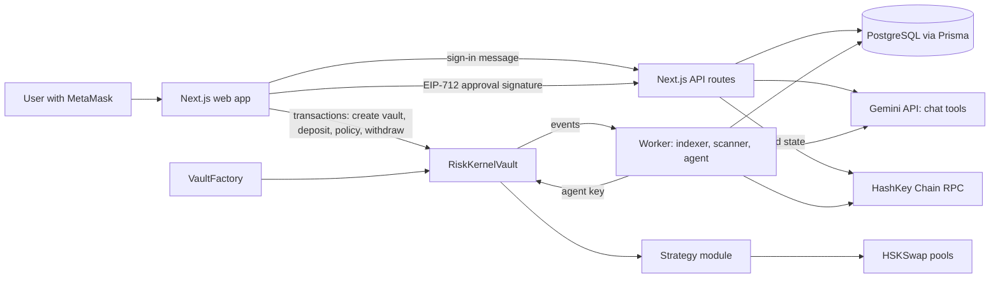
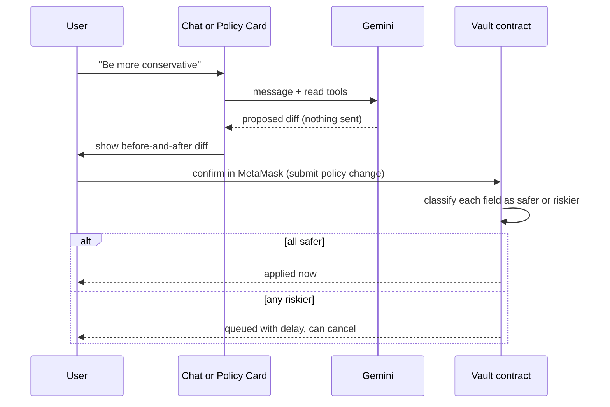
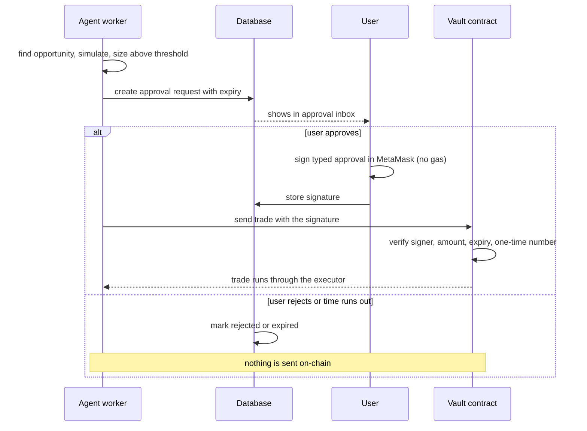
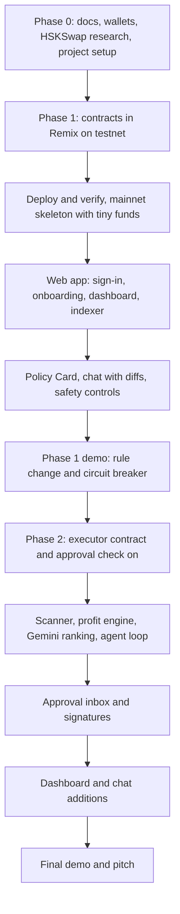

# Risk Kernel — Implementation Plan

**Product:** Risk Kernel (see `risk-kernel-vault-plan-v2.md` for the product plan)
**Chain:** HashKey Chain (testnet first, then mainnet)
**Status:** Planning document. No code yet.

---

## 0. Assumptions and items to confirm

| # | Item | Assumption in this plan | Action |
|---|---|---|---|
| 1 | **"Open UI"** | I read this as an open-source component library and picked **shadcn/ui (Radix + Tailwind)** because it is the fastest to assemble in Next.js | Tell me if you meant a different library and I will adjust |
| 2 | **HSKSwap internals** | Unknown whether it is a V2-style or V3-style (Uniswap-like) DEX. Router, factory and pool addresses are **not verified** | Phase 0 task: read a swap transaction on the explorer and identify the router and pool types |
| 3 | **Base asset** | One stablecoin on HashKey Chain (USDT or USDC) is the vault's base asset | Phase 0: confirm which stablecoin has real liquidity on HSKSwap, and its contract address |
| 4 | **Gemini model** | A fast, low-cost Gemini "Flash"-class model with function calling and structured JSON output | Confirm the exact model ID in Google AI Studio on build day |
| 5 | **Team size** | Effort estimates assume 2 developers | Rescale if different |
| 6 | **Hackathon deadline** | Not confirmed (the DoraHacks page did not load for me) | Check dates and judging criteria and fit the phases to them |

---

## 1. Tech stack

| Layer | Choice | Why |
|---|---|---|
| Web app | **Next.js** (App Router, TypeScript) | One codebase for pages and API routes |
| UI | **shadcn/ui** + Tailwind | Fast, clean components (see assumption 1) |
| Wallet, sign-in, funds | **MetaMask** via **ethers v6** | Direct browser provider, no extra wallet SDK |
| AI | **Gemini API** (server-side only) | Function calling for chat tools, structured JSON for ranking |
| Database | **PostgreSQL + Prisma** (hosted, for example Neon or Supabase) | Stores indexed events, users, approvals, opportunities |
| Contracts | **Solidity (0.8.x)** written and deployed in **Remix IDE** | As requested. OpenZeppelin libraries imported inside Remix |
| Background worker | Small **Node.js** process in the same repo | Runs the scanner and the agent loop (Phase 2) and the event indexer |
| Hosting | Vercel for the web app. Railway or Render (or a local machine for the demo) for the worker | Vercel is poor for long-running loops, so the worker runs separately |

---

## 2. What HashKey Chain features we use

| HashKey feature | How we use it |
|---|---|
| **EVM compatibility** | Standard Solidity, MetaMask, ethers, Remix |
| **HSK as gas token** | Every user and the agent wallet need a little HSK for fees |
| **Mainnet and testnet networks** | Build and test on testnet, deploy the final contracts on mainnet |
| **Block explorer (Blockscout)** | Contract verification, transaction links in the UI, finding HSKSwap's router and pools |
| **Testnet faucet** | Free test HSK for development |
| **RPC and node providers** | Reliable endpoint for the indexer and worker, since log polling can hit public rate limits |
| **Fee documentation** | Understand how gas is charged so profit estimates include the real cost |
| **HSKSwap (the DEX)** | The trading venue for the arbitrage cycles |
| **Safe (multisig)** | Optional: owner of the factory admin role on mainnet |
| **Subgraph support** | Optional upgrade over our own event poller (The Graph lists HashKey Chain mainnet) |
| **Oracle** | Not needed in the MVP because the vault measures value only in its base asset. Listed for later |
| **KYC (identity)** | Not needed in the MVP. A natural roadmap item for a compliance-focused chain |

**Network values (verified from public sources, re-check against the official Network Info page):**

| | Mainnet | Testnet |
|---|---|---|
| Chain ID | 177 (hex 0xb1) | 133 (hex 0x85) |
| Public RPC | https://mainnet.hsk.xyz | https://testnet.hsk.xyz |
| Explorer | https://hashkey.blockscout.com | https://testnet-explorer.hsk.xyz |
| Currency | HSK, 18 decimals | HSK, 18 decimals |

**From your screenshots (Faucet page):** the official testnet faucet is faucet.hsk.xyz. It may rate-limit requests, and the docs say to contact the HashKey Chain team if you need more. An alternative route is bridging Sepolia WETH to HashKey testnet using the documented bridge. The page also shows a stray raw `<Note>` tag, which is only a docs formatting glitch.

---

## 3. Key design decisions (kept simple on purpose)

1. **The vault measures its value only in its base asset.** Every trade is a *cycle* that starts and ends in the base asset (for example USDT → token → USDT). Between trades the vault holds only the base asset.
   - No oracle is needed.
   - The drawdown check is a plain balance comparison.
   - "Move to a stable asset" on freeze is automatic, because the vault is already in the stable asset.
2. **Vault calls a strategy module, then checks the result itself.** The vault sends the trade amount to an allowed module (a separate contract that talks to HSKSwap). The module must return funds to the vault in the same transaction. The vault then verifies its own balance. The vault never trusts the module's report.
3. **Policy changes are normal MetaMask transactions.** The wallet confirmation *is* the owner's signature. The contract itself works out whether each change is safer or riskier. Safer-only changes apply at once. If anything is riskier, the whole update is queued behind a delay the owner can cancel.
4. **Large-trade approvals use an off-chain signature (EIP-712).** The owner signs an approval for one specific trade, at no gas cost. The backend attaches it to the trade transaction, and the vault checks it.
5. **The AI cannot move money.** Gemini gets read tools and one "propose change" tool that returns a diff for the user to confirm. It has no tool that sends a transaction.
6. **Numbers never come from the AI.** Balances and profit and loss come from chain data and our database. Profit estimates come from deterministic code. Gemini only ranks, explains, and turns requests into diffs.
7. **The approval check is written into the vault contract in Phase 1 but left switched off** (threshold set to "disabled"). Phase 2 turns it on and tests it. This avoids redeploying vaults mid-hackathon.
8. **Worst-case loss bound.** A trade that ends below the loss floor does not revert. It completes and then freezes the vault, because a revert would also undo the freeze. So the maximum overshoot is one trade's size multiplied by the slippage limit. State this honestly in the pitch.

---

## 4. System architecture

---

## 5. Contracts overview

| Contract | Phase | Purpose |
|---|---|---|
| **VaultFactory** | 1 | Creates a vault for each user, stores the default settings, keeps a public list of vaults |
| **RiskKernelVault** | 1 (approval check switched on in 2) | Holds funds, stores the mandate, enforces limits, runs the circuit breaker, handles policy changes |
| **BasicSwapModule** | 1 | A simple module that does one allowed swap cycle through HSKSwap with a slippage guard, so the agent can trade and the circuit breaker can be demonstrated |
| **Mock token, mock pool** | 1 (testnet only) | Lets us force a loss and a spread on testnet for the demo |
| **ProfitOrRevertExecutor** | 2 | A module that runs multi-step cycles and reverts unless profit meets a minimum |

### 5.1 Mandate fields and direction rules

The contract decides whether a change is **safer** (instant) or **riskier** (delayed).

| Field | Meaning | Safer when |
|---|---|---|
| Max drawdown | Loss from the vault's peak that freezes the agent | Value goes **down** |
| Max position size | Largest single trade | Value goes **down** |
| Max daily volume | Total traded per day | Value goes **down** |
| Max slippage | Allowed price movement per trade | Value goes **down** |
| Allowed tokens | Tokens the cycle may touch | A token is **removed** |
| Allowed pools | Pools the cycle may use | A pool is **removed** |
| Allowed modules | Strategy contracts the vault may call | A module is **removed** |
| Approval threshold | Trade size above which owner approval is required | Value goes **down** |
| Agent address | The one wallet allowed to request trades | Revoking is safer. Granting or replacing is riskier |

Waiting period for riskier changes: a fixed value set when the factory is deployed (short on testnet for demos, longer on mainnet).

### 5.2 Vault functions (plain English)

| Action | Who | What it does |
|---|---|---|
| Deposit | Owner | Adds base asset and raises the peak value by the same amount |
| Withdraw | Owner | Always allowed, even when paused or frozen. Lowers the peak value proportionally so withdrawing is never mistaken for a loss |
| Submit policy change | Owner | Contract classifies each field. All safer → applies now. Any riskier → queued |
| Cancel queued change | Owner | Removes a pending riskier change |
| Apply queued change | Anyone, after the delay | Activates the queued change |
| Grant or revoke agent | Owner | Revoke is instant |
| Pause and resume | Owner | Pause blocks the agent at once |
| Unfreeze | Owner | Clears the frozen state and resets the peak to the current balance |
| Execute strategy | Agent only | Sends funds to an allowed module, checks all limits before and after, updates daily volume, freezes if the loss floor is crossed |

### 5.3 Checks inside "execute strategy"

Before the trade: vault not paused or frozen, caller is the agent, module is allowed, size within the position and daily limits, route uses only allowed tokens and pools, slippage within limit, and (Phase 2) a valid owner approval if the trade is above the threshold.

After the trade: the base asset is back in the vault, the balance is not lower than the slippage allowance, and the daily volume is updated. If the balance is below the loss floor, the vault freezes and emits an event.

### 5.4 Safety checklist for the contracts

- Reentrancy guard on every function that moves funds
- Safe token transfer helpers and no tokens with transfer fees
- Checks first, state changes next, external calls last
- No delegate calls and no arbitrary calls from the agent
- The vault gives a module only the exact amount for the trade and leaves no standing approvals
- Events for every important action (these feed the dashboard)
- Clear owner-only and agent-only guards, tested for each function

---

## 6. Database design (Prisma, kept minimal)

| Model | Phase | Fields (summary) |
|---|---|---|
| **User** | 1 | wallet address, sign-in nonce, created time |
| **Vault** | 1 | vault address, owner, base asset, created block, cached settings |
| **ActivityEvent** | 1 | vault, event type, transaction hash, log index, block, time, decoded details |
| **IndexerCursor** | 1 | last processed block |
| **ChatMessage** | 1 | user, role, text, time (optional history) |
| **Opportunity** | 2 | vault, route, estimated profit, status (skipped, sent, completed, cancelled), reason |
| **ApprovalRequest** | 2 | vault, opportunity, trade amount, summary, expiry, status (pending, approved, rejected, expired), signature |

---

## 7. API routes

| Route | Phase | Purpose |
|---|---|---|
| Auth: get nonce, verify signature, sign out | 1 | Wallet sign-in with a signed message and a session cookie |
| Vaults: list mine, get one | 1 | Reads from chain and database |
| Activity: list for a vault | 1 | From indexed events |
| Chat | 1 | Sends the message to Gemini with the read tools and the propose-change tool |
| Opportunities: list | 2 | Feed for the dashboard |
| Approvals: list pending, submit signature, reject | 2 | Human-in-the-loop inbox |
| Worker health | 2 | Shows the last scan time and agent status |

---

## 8. Phase 0 — Preparation (do this first)

| Task | Output |
|---|---|
| Read the HashKey docs listed in section 13 | Notes on network, fees, tools |
| Fund two wallets with testnet HSK: an **owner** wallet and an **agent** wallet | Ready for testing |
| Open HSKSwap, perform a tiny swap on **testnet or mainnet**, and inspect the transaction on the explorer | Router address, pool type (V2 or V3 style), fee tiers |
| List the tokens and pools with real liquidity on mainnet HSKSwap | Candidate cycles, base asset choice |
| Create the Next.js project, Prisma schema, environment file, and a Remix workspace | Skeleton ready |
| Check the DoraHacks page for deadline and judging criteria | Schedule fitted to the hackathon |

**Environment variables to prepare:** database URL, session secret, Gemini API key, RPC URLs for testnet and mainnet, chain selection flag, agent private key (worker only, never in the web app), factory and module addresses, base asset address.

---

## 9. Phase 1 — Risk Kernel Vault + Policy Cards with signed diffs

**Goal:** A user can create a vault with rules built in, deposit, watch it, change its rules safely through chat or the Policy Card, withdraw, and see the circuit breaker freeze the agent.

### 9.1 Build steps

| # | Step | Details | Effort |
|---|---|---|---|
| 1 | **Contracts in Remix** | Write VaultFactory, RiskKernelVault, BasicSwapModule. Add mocks for testnet | 2–3 days |
| 2 | **Test in Remix on testnet** | Walk through every function and every failure case (see test table) | 1 day |
| 3 | **Deploy and verify** | Deploy factory and module on testnet, verify on the explorer. Deploy the same set on **mainnet with tiny funds** to lock in the mainnet requirement early | 0.5 day |
| 4 | **Web app shell** | Next.js, shadcn components, network switch helper (add or switch to HashKey Chain in MetaMask) | 0.5 day |
| 5 | **Wallet sign-in** | Nonce, signed message, server verification, session | 0.5 day |
| 6 | **Indexer** | Worker polls the factory and vault events from the last stored block and writes them to the database | 1 day |
| 7 | **Onboarding wizard** | Risk profile choice or free text, Policy Card preview, create vault, approve and deposit | 1–1.5 days |
| 8 | **Dashboard** | Balance, peak value, profit and loss, risk gauge (distance to the loss floor), activity feed, frozen banner | 1 day |
| 9 | **Policy Card page** | Current rules, pending change with countdown, cancel button, safer or riskier labels | 1 day |
| 10 | **Chat with Gemini** | Tools described in 9.2, diff confirmation component that triggers the MetaMask transaction | 1–1.5 days |
| 11 | **Safety controls** | Pause, revoke agent, withdraw, unfreeze | 0.5 day |
| 12 | **Agent test script** | A small script using the agent key to request a basic cycle, used to produce trades and to force a loss on testnet | 0.5 day |

Rough total: about 10–12 working days for one person, so about 5–7 days for two. Compress by cutting polish first.

### 9.2 Chat tools for Gemini (Phase 1)

| Tool | Type | Returns |
|---|---|---|
| Get vault summary | Read | Balance, peak value, profit and loss, frozen or paused status |
| Get policy | Read | Current mandate and any queued change |
| Get recent activity | Read | Latest indexed events |
| Propose policy change | Draft only | A structured diff (field, old value, new value, safer or riskier) shown on screen. **It never sends a transaction** |

Chat rules: answer numbers only from tool results, never invent figures, and say so when data is missing.

### 9.3 Policy change flow

### 9.4 Phase 1 tests

| Test | Expected result |
|---|---|
| Create vault, deposit, withdraw | Balances correct. Peak value follows deposits and withdrawals |
| Agent calls without being granted | Rejected |
| Trade above position or daily limit | Rejected |
| Trade with disallowed token or pool | Rejected |
| Trade with slippage above the limit | Rejected |
| Safer-only policy change | Applies immediately |
| Riskier policy change | Queued, cannot apply early, can be cancelled, applies after the delay |
| Mixed change | Whole update queued |
| Forced loss on testnet mock pool | Vault freezes, agent blocked, owner can still withdraw |
| Pause | Agent blocked at once |
| Withdraw while frozen | Succeeds |
| Gemini asked to "withdraw everything" | No transaction is created. It can only explain how the user does it |

### 9.5 Phase 1 done when

- Vault factory and vault are live on **HashKey mainnet** and verified on the explorer
- A user can create a vault, deposit, and see a live dashboard
- A rule change by chat becomes a diff and is applied only after the user confirms in MetaMask
- Tightening applies instantly. Loosening waits and can be cancelled
- The circuit breaker freeze is shown on testnet with the mock pool
- Chat answers about balance and history match what is on the explorer

---

## 10. Phase 2 — Profit-or-Revert Executor + Human-in-the-Loop Threshold

**Goal:** The agent finds spreads on HSKSwap and trades them in cycles that cancel unless profitable. Trades above the user's threshold wait for a signed approval.

### 10.1 Build steps

| # | Step | Details | Effort |
|---|---|---|---|
| 1 | **Executor contract** | Multi-step cycle through allowed pools. Records the vault's base balance before, runs the route, and reverts unless the return is at least the amount plus the required minimum profit | 1.5–2 days |
| 2 | **Switch on the approval check** | Turn on the vault's approval verification (already written in Phase 1) and test it with the new module | 1 day |
| 3 | **Register the executor** | Add the executor to the allowed modules for test vaults through the normal policy flow | 0.5 day |
| 4 | **Scanner** | Worker reads pool prices for candidate cycles on HSKSwap and builds routes | 1.5–2 days |
| 5 | **Profit engine** | Deterministic code estimates output after pool fees, slippage and gas, and sets the minimum profit | 1 day |
| 6 | **Gemini ranking** | Candidate list goes in as structured data. Gemini returns a ranked choice with a plain explanation as structured JSON. Its output cannot alter numbers | 0.5 day |
| 7 | **Dry run before sending** | Simulate each trade first (read-only call). Skip it if the simulation fails, so no gas is spent | 0.5 day |
| 8 | **Agent loop** | For each active vault: pick the top opportunity, check threshold, send directly or create an approval request | 1 day |
| 9 | **Approval API and inbox** | Approval request records, in-app inbox with countdown, approve (MetaMask typed-data signature) and reject buttons, expiry job that marks silent requests as rejected | 1.5 days |
| 10 | **Dashboard additions** | Opportunity feed, counts of completed and cancelled trades, pending approvals badge | 1 day |
| 11 | **Chat additions** | New read tools for opportunities and pending approvals, and a draft tool to change the threshold | 0.5 day |
| 12 | **Demo preparation** | Testnet mock pools with a deliberate spread, scripted runs for a success, a cancellation and an approval | 1 day |

Rough total: about 11–13 working days for one person, or about 6–7 days for two.

### 10.2 Executor behavior (plain English)

1. The agent passes a route, an amount and a minimum profit.
2. The vault checks all limits and sends the amount to the executor.
3. The executor runs each step through the allowed pools.
4. The executor returns the base asset to the vault.
5. If the vault's balance is not at least the starting amount plus the minimum profit, the whole transaction reverts. Only the network fee is spent.
6. Otherwise the trade completes and the profit is recorded in an event.

### 10.3 Approval flow

**What the approval signature covers:** the vault, the exact amount, the route, the minimum profit, an expiry time, and a one-time number so it cannot be reused.

### 10.4 Phase 2 tests

| Test | Expected result |
|---|---|
| Profitable cycle | Completes, profit recorded |
| Cycle with profit below minimum | Reverts, only the fee is lost |
| Spread disappears between simulation and sending | Reverts safely |
| Trade below threshold | Runs automatically |
| Trade above threshold with no signature | Rejected |
| Trade above threshold with a valid signature | Runs |
| Expired signature | Rejected |
| Reused signature | Rejected |
| Signature from a different wallet | Rejected |
| Signature for a different amount or route | Rejected |
| User ignores a request | Marked expired, nothing sent |
| Executor not on the allowed list | Rejected |
| Loss limit reached after a trade | Vault freezes |

### 10.5 Phase 2 done when

- The executor is live on **mainnet**, registered on a test vault, and has executed at least one real small cycle, if a real spread exists
- A cancelled trade is shown on-chain (testnet if no mainnet spread appears)
- Large trades are blocked until the user signs, and silence means rejection
- The dashboard shows opportunities, completed trades, cancelled trades and pending approvals
- Chat can answer "what are you waiting on me for?"

---

## 11. Build order summary

---

## 12. Remix workflow notes

1. **Compiler:** pick a recent 0.8.x version with the optimizer on. If a deployment fails with an "invalid opcode" style error on HashKey Chain, lower the EVM version in the Remix compiler settings (for example to Paris) and recompile.
2. **Imports:** import OpenZeppelin contracts directly inside Remix, and keep the same version for every contract.
3. **Network:** in the Deploy tab choose **Injected Provider – MetaMask**, switch MetaMask to testnet (133) first, and to mainnet (177) only for the final deployments.
4. **Testing:** Remix has a built-in unit-test plugin, but a forked HashKey chain is not available there. Use testnet with mock tokens and a mock pool for realistic tests.
5. **Verification:** flatten the source files and verify each contract on the Blockscout explorer. Keep the compiler version, optimizer settings and constructor arguments written down.
6. **Record keeping:** save every deployed address, the transaction hash and the ABI in one shared file. The web app and worker read from it.
7. **Mainnet caution:** keep funds tiny and use separate owner and agent wallets.

---

## 13. HashKey documentation you need

Your screenshots show the docs site's sections. This is what to read, in order of need.

| Priority | Docs section | What to get from it |
|---|---|---|
| **Before Phase 0** | **Network Info** | Chain IDs, RPC URLs, explorer, currency, any L2 details |
| **Before Phase 0** | **Wallets** | How to add HashKey Chain to MetaMask |
| **Before Phase 0** | **Faucet** (you have this) | Testnet HSK and the rate-limit note |
| **Before Phase 0** | **Explorer** | How to verify contracts and read transactions |
| **Phase 0** | **RPC & Node Provider** | Better endpoints and rate limits for the indexer and worker |
| **Phase 0** | **Fee** | How gas and any extra data fees are calculated, needed for profit estimates |
| **Phase 0** | **Bridges** | How to move assets onto HashKey Chain, including stablecoins for the vault |
| **Phase 1 or 2** | **Oracle** | Which oracle providers exist on HashKey Chain. Not needed for the MVP |
| **Optional** | **Safe** | Multisig for admin ownership on mainnet |
| **Optional** | **Subgraph** | Faster history queries than our own poller |
| **Optional** | **KYC** | Identity token for a compliance-minded roadmap |
| **Optional** | **Knowledge: DeFi, Smart Contracts, Reentrancy Attack, Gas, Layer 2** | Background reading. The Reentrancy Attack page is worth reading before writing the vault |
| **If you need support** | **Get help, Apply for Grants, Bug bounty** (links at the bottom of your second screenshot) | Support channel and funding after the hackathon |

**Not in the HashKey docs, but needed:**

| Source | What to get from it |
|---|---|
| **HSKSwap app and the explorer** | Router, factory and pool addresses and pool type. Read a swap transaction to find them |
| **Token contracts on the explorer** | The base stablecoin address and decimals |
| **Remix documentation** | Deploying with MetaMask, verification, compiler settings |
| **OpenZeppelin docs** | Reentrancy guard, safe transfers, typed-data signature verification |
| **EIP-712 specification** | How the approval signature is structured |
| **MetaMask docs** | Adding or switching networks and signing typed data |
| **Gemini API docs** | Function calling and structured JSON output |
| **Prisma and Next.js docs** | Schema, migrations, API routes |

---

## 14. Risks and how to handle them

| Risk | Mitigation |
|---|---|
| HSKSwap has too little liquidity for real spreads | Scan every pool combination. Be open in the demo. Show the mechanism on testnet mock pools and show real cancelled-trade behavior |
| Router or pool type differs from our assumption | Phase 0 research before writing the executor. The module design keeps DEX-specific code in one contract |
| Loss overshoot beyond the drawdown limit | Documented bound: one trade's size multiplied by slippage. Keep position caps small in the demo |
| Remix has no fork testing | Use testnet mocks. Add Foundry fork tests later if time allows |
| Public RPC rate limits break the indexer | Use a provider from the RPC docs page, and poll in modest batches |
| Gemini mistakes or invents numbers | Chat can only use tool results. The ranking output is validated against the candidate list |
| Agent key leaks | Key lives only in the worker environment. It is limited by the vault, can be revoked instantly, and the agent wallet holds only a little HSK for gas |
| Scope too big | Phase 1 is a complete product by itself. Cut Phase 2 polish (scanner extras, dashboard details) before touching Phase 1 |
| Unaudited contracts | Say so openly. Plan an audit before any real user funds |

---

## 15. Demo scripts

**After Phase 1 (about 3 minutes):**
1. Connect, describe risk in words, show the Policy Card, create the vault.
2. Deposit and show the dashboard and risk gauge.
3. Say "be more conservative", show the diff, confirm, and see it apply instantly.
4. Request a looser rule, show the queue and cancel it.
5. On testnet, run the agent's loss trade and show the vault freeze, and withdraw while frozen.

**After Phase 2 (about 5 minutes):** repeat the steps above briefly, then:
1. Show the live opportunity feed and a trade that completes with its profit.
2. Show a trade that cancelled because the profit fell short, costing only the fee.
3. Trigger a trade above the threshold, show the approval request, sign it, and watch it execute.
4. Show another request being rejected or expiring, with nothing sent on-chain.
5. Ask the chat "what are you waiting on me for?"

---

## 16. Next steps

1. Confirm the open items in section 0 (especially the UI library and the DoraHacks deadline).
2. Finish Phase 0 research on HSKSwap, since it sets the executor's design.
3. Write the exact Policy Card field list and contract function list (names and parameters) as a short spec before opening Remix.
